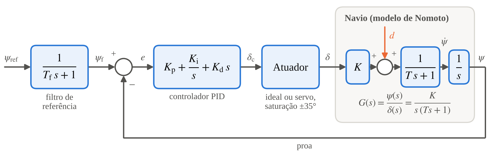

# Prova de conceito do controle de proa (TCC C-ApA-Of 2026)

Código da simulação usada na prova de conceito do trabalho de conclusão de curso
**"Otimização da automação do sistema de governo de um navio-patrulha: diagnóstico e
programa de recuperação e modernização"**, de Arthur dos Santos Sousa, Primeiro-Tenente,
apresentado ao Curso de Aperfeiçoamento Avançado para Oficiais (C-ApA-Of) 2026, no CIAA.

[](https://colab.research.google.com/github/ArthurSantos1T/tcc-controle-de-proa/blob/main/prova_de_conceito.ipynb)

## O que é simulado

A malha simulada, que é a Figura 2 do TCC, tem quatro partes:

- um **filtro** que suaviza a mudança da proa pedida;
- um **controlador PID**, no papel do piloto automático, que calcula a ordem de leme;
- um **atuador**, que representa a máquina do leme e transforma a ordem na posição do leme;
- o **navio**, pelo modelo de Nomoto de primeira ordem, que diz como o ângulo do leme muda a proa.



A função de transferência G(s) = ψ(s)/δ(s) = K/[s(Ts + 1)] representa só o bloco do navio,
com K = 0,7 (graus/s)/grau e T = 60 s. A proa medida volta ao controlador pela realimentação,
que corresponde à agulha giroscópica e foi considerada ideal. A perturbação d, em graus por
segundo, representa de forma simplificada o vento ou a corrente.

O modelo é o exemplo publicado por Świder, Trybus e Stec (2023) e **não representa o navio
estudado**. A simulação demonstra o método. Os números não são ajustes para nenhum navio.

## O que o código faz

1. Compara duas regras de sintonia do PID: a regra-padrão de Fossen e a da Tabela 1 de
   Świder, Trybus e Stec. O cenário é uma mudança de proa de 0° para 10° em t = 30 s, com
   uma perturbação constante de 0,10°/s entre 480 s e 600 s. Nessa comparação, o atuador é
   ideal.
2. Calcula os indicadores: erro de proa acumulado (IAE), tempo de assentamento na faixa de
   ±0,5°, sobressinal, maior desvio sob perturbação e atividade do leme (Aδ).
3. Varre a razão de projeto r de 1 a 4 e escolhe o r que minimiza
   J(r) = IAE/IAE(2) + λ·Aδ/Aδ(2), para λ = 0,5, 1 e 2.
4. Simula a máquina do leme nominal (2,3°/s e 0,5 s de atraso) e degradada (até 0,2°/s e
   8 s de atraso). O resultado mostra que a degradação quase não aparece na proa, mas aparece
   na comparação entre a ordem e a posição do leme.

## Como rodar

**No navegador, sem instalar nada:** clique no botão *Abrir no Colab* acima e depois em
*Ambiente de execução → Executar tudo*. Se aparecer o aviso de que o notebook não foi criado
pelo Google, clique em *Executar mesmo assim*. Em cerca de um minuto aparecem os números e
as figuras.

**No computador**, com Python 3.10 ou mais recente:

```
pip install -r requirements.txt
python simulacao_prova_de_conceito.py
```

As figuras e o arquivo `resultados.txt` são gravados na pasta `saida`. O código foi testado
com Python 3.13, NumPy 2.5 e Matplotlib 3.11.

## Arquivos

| Arquivo | Conteúdo |
| --- | --- |
| `simulacao_prova_de_conceito.py` | Simulação completa, a mesma do Apêndice C do TCC |
| `prova_de_conceito.ipynb` | Notebook para rodar no Google Colab |
| `saida_referencia/` | Saídas esperadas, para conferência |
| `docs/malha_simulada.png` | Diagrama de blocos da malha (Figura 2 do TCC) |

## Correspondência com o TCC

| Saída | No TCC |
| --- | --- |
| `fig09_proa_erro.png` | Figura 11 |
| `fig10_ordem_perturbacao.png` | Figura 12 |
| `fig11_compromisso_r.png` | Figura 13 |
| `fig12_degradacao_atuador.png` | Figura 14 |
| `resultados.txt` | Tabelas 14, 15 e 16 |

## Referência

ŚWIDER, Z.; TRYBUS, L.; STEC, A. Consistent design of PID controllers for an autopilot.
*Polish Maritime Research*, v. 30, n. 1, p. 78–85, 2023. DOI: 10.2478/pomr-2023-0008.
A regra-padrão de Fossen é usada na forma apresentada nesse artigo.

## Licença

Código aberto sob a licença MIT (arquivo `LICENSE`).
